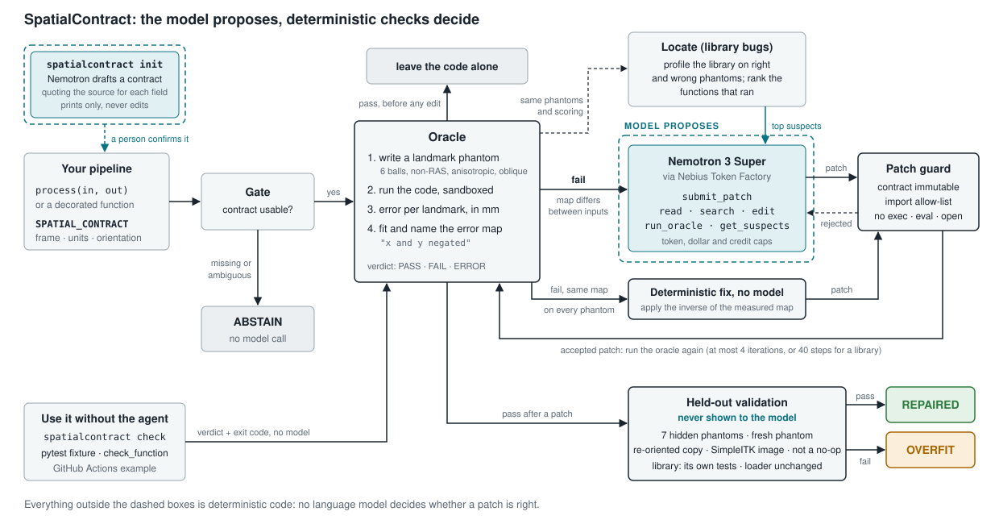

# SpatialContract

**Finds and repairs the bugs that put medical images in the wrong place, and checks every fix against physics instead of the model's opinion.**

Built for the Nebius x NVIDIA Global AI Hackathon (track: Coding and Agentic Engineering). Imaging pipelines in Python: nibabel, SimpleITK, MONAI, TorchIO, nilearn.

## Why this matters
- **Spatial bugs are silent.** A flipped axis, an affine left stale after a crop, RAS read as LPS, or millimetres written where metres were declared: nothing crashes and the image looks valid, it is just in the wrong place. The data-side version of the same error, a wrong orientation in the image header, is "surprisingly common" in public MRI datasets and invisible by eye, because brains are nearly symmetric ([Glen et al. 2020](https://doi.org/10.3389/fninf.2020.00018)); code that writes headers is one way it gets there.
- **They ship.** A bug in TorchIO 2.0a (fixed in April 2026) handed RAS affines to SimpleITK without converting to LPS, so every image saved that way moved by up to 123 mm. This repo reproduces eight such fixed bugs from TorchIO, nibabel, MONAI and nilearn. In our seeded corpus, 12 of 31 bugs pass the ordinary unit tests written for their pipelines.
- **A coding agent needs something it cannot argue with.** Given a script "reported as wrong" and no check that passes correct code, the same Nemotron model rewrote already-correct code in 16 to 26 of 33 runs and guessed a convention in 9 to 16 of 21 cases where the convention could not be known, even with an `abstain` tool available. Agents special-casing or editing tests is a measured failure mode in general ([ImpossibleBench](https://arxiv.org/abs/2510.20270)).

## What it does


A pipeline declares a contract; a gate abstains when it is missing or ambiguous. The oracle measures where landmarks land and describes the error. Only on a failure does the model get involved, and every patch it proposes goes back through the guard, the oracle and finally checks it never saw. For bugs inside a library, a runtime trace ranks suspect functions first. The same oracle runs on its own from the CLI, pytest or CI.

**See it:** the demo page (`docs/index.html`, self-contained, 12 recorded real runs, including three repairs inside real libraries) shows each phantom's landmarks in 3D world millimetres: blue rings where each landmark must be, orange dots where the original code put it, green diamonds where it lands after the agent's patch. Or run `python scripts/demo.py replay L04_right_multiply` in a terminal.

## What we found
| question | answer |
|---|---|
| Did the libraries' own tests catch these bugs? | **No, 0 of 8.** At each pre-fix commit we ran the library's test files that cover the fixed code (`python scripts/run_prefix_tests.py`, no tokens): every one passed, apart from failures that also occur on the fixed code in our environment. The regression test the fix added catches the bug in 5 of 8 cases; 2 fixes added no test; in 1 (MONAI `Spacing`) the new test also fails on the fixed code here, so it is inconclusive |
| Do the repairs hold on real scans, not only phantoms? | **Yes, on every one we ran.** Four real scans (three real acquisitions: nibabel's T1 and oblique EPI test scans, and the Colin27 brain, the last stored in two layouts), where the input itself is the ground truth: each output voxel must hold the anatomy found at that physical point of the input (`python scripts/validate_real_scans.py`, no tokens). All 91 phantom-validated seeded repairs pass on all 4 scans; for pipelines that only reorient, crop or re-express coordinates they reproduce the input exactly (correlation 1.000, 288 of 288 runs). All 16 library repairs that passed the oracle (agent and staged runs) produce output identical to the upstream fix on every scan (64 of 64), including repairs whose code differs from upstream; this goes through the driver, so the three of them that the library gates below reject look correct here too. All 31 buggy originals fail on at least one real scan; the 11 correct controls pass (the threshold is calibrated on them) |
| Does the oracle catch real bugs that shipped in public libraries? | **8 of 8 reproduced** at the pre-fix commit (TorchIO 3, nibabel 2, MONAI 2, nilearn 1); 5 of 8 on the first attempt, 3 after the oracle or the repro was adjusted. Three of the eight are caught by the declared output orientation, with every landmark in the right place. One further candidate (TorchIO #1310) is invisible to it by design; see the limitations |
| Does it raise false alarms on correct code? | Not on any correct pipeline we have: 11 correct seeded controls, the post-fix version of all 8 real bugs, and correct pipelines that resample with linear or cubic interpolation or normalise intensities (z-score, rescaling) all pass. The last group used to FAIL: an outside review caught it, and the oracle now also reads landmarks as intensity blobs, a reading that can only turn a failure into a pass when every landmark is where it belongs (no earlier verdict changed) |
| Can a cheap runtime trace find the bug inside a library, with no model? | the file the upstream fix edited is in the trace's top 10 for **8 of 8** real bugs, the function itself in the top 5 for 4 of 8. Baselines on the same executed functions: random order 3.2 of 8 and 0.6 of 8; "functions the driver names first" 6 of 8 and 2 of 8 (it is better at file top 3, 6 vs 4, and much worse when the bug is away from the called API: MONAI's offset bug ranks 20th with the trace, 899th by name) |
| Can the agent repair bugs inside real libraries? | **Sometimes.** With the trace (`real4`): 4 of 16 runs repaired (3 of the 8 bugs); 9 of 16 runs edited a file the upstream fix edited. On the original seven bugs that is 3 of 14 runs, the same as without the trace (`real3`: 3 of 14 runs (2 of the 7 bugs); all 11 failures ended on the 300k-token cap). The trace gets the agent to the right code more often; writing the fix, when it needs an understanding of the algorithm, is where it fails |
| Which repair method works best inside libraries? | **Staged repair**: the trace's top suspect functions go to the model with their source, it proposes whole-function rewrites, the oracle picks. **5 of 16 runs verified (3 of the 8 bugs) for $0.32 in total, $0.06 per verified repair**, against $0.36 for the tool-calling agent, and it fixed TorchIO `Crop`, which no agent run did. A repair counts as verified only if it also passes two library gates: the library's own covering tests must not newly fail, and the library's loader must report the same affine as before. They rejected 3 staged repairs that passed every phantom check (two flipped TorchIO's reader, making `image.affine` 134 mm wrong; one broke 18 of MONAI's own orientation tests). Staged first and the agent only where it fails verifies 2 and 4 bugs in the two repetitions, against 1 and 3 for the agent alone, at a similar cost. A model-free mutation search over the same suspects "repaired" `Crop` by deleting the crop, which the no-op check and the regression gate both reject; it ran on 3 of the 8 bugs before the machine ran low on memory. Across all methods 4 of the 8 bugs have a verified repair (`python scripts/compare_repair.py`) |
| Does every bug need the model? | No. When the oracle measures the same misplacement on every visible phantom (a units scale, a missing RAS/LPS conversion) or only the output orientation is wrong, a deterministic correction fixes it with no model call: **8 of 31 seeded bugs, all passing held-out validation, 0 controls touched** (`python scripts/evaluate_autofix.py`). Trying that first keeps the repair rate at 98% and cuts model tokens on the seeded bugs by 18% (299k to 245k). The other 23 bugs move landmarks differently on each input, so no single correction exists and the model is needed |
| Seeded bugs: which feedback repairs more? | no feedback 86%, our original unit tests 86%, a **stronger unit-test suite 97%**, oracle feedback **98%**. Oracle vs original tests: +12 points (95% CI +3 to +22). Oracle vs stronger tests: **+1 point (CI 0 to +3)** (3 repetitions, one model) |
| Does it leave correct code alone and refuse to guess? | **With the same gate for every arm** (skip the model when the arm's own check passes on the original script; `python scripts/analyze_gating.py`, no tokens): correct code modified 0 of 33 with the original tests, the stronger tests or the oracle. Must-abstain cases patched: original tests 6 of 21, stronger tests 12 of 21, oracle 0 of 21. Repair under that gate: original tests 58% (they pass 12 bugs and so never call the model on them), stronger tests 97%, oracle 98% |
| ...and without a gate? | as originally run, the test arms called the model on every script: correct code modified by no feedback 16 of 33 (broke 10), original tests 18 (broke 8), stronger tests 26 (broke 4); must-abstain cases patched by no feedback 9 of 21, original tests 16, stronger tests 14. The gated agent: 0 of 33 runs, and it abstains on 21 of 21 runs |

**How to read this.** Any check that passes correct code protects correct code once you gate on it; that is not special to the oracle. What differs is what the check costs and what it can say. Our ordinary unit tests make a safe gate but a weak one (58% repaired, because they pass 12 of the bugs). A hand-written landmark suite is as good as the oracle at repairing and at leaving correct code alone; it is about 90 lines with one expected-position function per pipeline family, written by us after the first evaluation, knowing the bug classes: a miniature oracle. The contract is one four-field dict per pipeline and the oracle is generic, and only the contract can say "the convention is unknown", which is why it alone never guessed (0 of 21). The seeded bugs are the oracle's own classes (circular), both unit-test baselines are ours, and 31 cases is small; the real-bug rows are the evidence that does not depend on our bug design.

## Use it on your own code
Decorate an in-memory function, or check a script from the command line or CI. Nothing here calls a model. Scope: a function or script that takes one 3D image (NIfTI-style data plus affine) and returns one; 4D series, DICOM series, multi-input registration and outputs in a template space are not covered yet.
```python
import nibabel as nib
from spatialcontract import spatial_contract, check_function

@spatial_contract(world_frame="RAS", units="mm")          # or signature="array": (data, affine) -> (data, affine)
def crop(img: nib.Nifti1Image) -> nib.Nifti1Image:
    ...                                                     # your code, unchanged; the decorator adds no wrapper

rep = check_function(crop)            # Report: .verdict PASS/FAIL/ERROR/ABSTAIN, .feedback(), .worst()

def test_crop(spatial_oracle):        # pytest fixture: fails the test with the oracle's mm feedback
    spatial_oracle(crop)
```
```bash
spatialcontract check pipelines/*.py      # exit 0 PASS, 1 FAIL, 3 ERROR, 4 ABSTAIN; prints e.g. "FAIL  worst landmark 25.3 mm off (phantom seed 0, label 6)"
```
No contract yet? `spatialcontract init pipeline.py` asks Nemotron to propose one, quoting the source text behind each field and marking it "stated" (the docstring or a name says the intent) or "inferred" (only what the code does), and "unknown" when nothing settles it. It never edits the file. On `examples/needs_contract.py` it reads RAS, mm and RAS orientation from the docstring and leaves the affine convention for you. On the seeded corpus with every contract removed (no docstrings or comments there, so only 11 of 196 fields could be "stated"), it mostly answers "unknown": usable for 3 of 11 correct controls (all 3 exact) and 6 of 31 buggy scripts (4 exact), and in 1 of those the code-based suggestion described the bug as the intent, so the oracle would then pass the bug. That is why it only prints: a person confirms the contract, and the gate abstains until they do (`scripts/evaluate_suggest.py`, about 83k tokens).

`examples/inmemory_example.py` shows a buggy and a fixed crop (FAIL 25.3 mm, PASS 0.00 mm). `examples/ci/spatialcontract.yml` is a GitHub Actions workflow that runs the check on every pull request.

## Quickstart
Python 3.10+. No GPU.
```bash
python -m venv .venv
.venv/Scripts/pip install -e ".[dev]"      # Linux/macOS: .venv/bin/pip
pytest                                      # 121 tests, about 4-5 minutes, no network, no API key (tests that need the library worktrees under _work/ skip themselves in a fresh clone)
python scripts/audit_docs.py                 # re-checks the numbers quoted in the docs against results/*
python scripts/demo.py replay L04_right_multiply   # terminal walkthrough of a recorded real run, no tokens
python scripts/demo.py serve                       # local web UI; paste any script that declares a SPATIAL_CONTRACT
```
To use the real model (Nebius Token Factory):
```bash
cp .env.example .env                       # put your key in NEBIUS_API_KEY; .env is gitignored
python scripts/list_models.py              # shows the Nemotron models, pricing and tool support (needs SC_ALLOW_API=1)
SC_ALLOW_API=1 python scripts/repair.py corpus/seeded/R05_stale_affine.py --budget 30000
SC_ALLOW_API=1 python scripts/demo.py serve --live --budget 60000      # adds the "Repair with Nemotron" button
SC_ALLOW_API=1 SC_TOKEN_CAP=14000000 python scripts/repair_real.py --localize --cases nilearn_reorder --budget 600000   # a bug inside a real library (needs _work/, see notes)
```
Token Factory calls are disabled unless `SC_ALLOW_API=1` is set for that command, and every call is capped by a persistent token ledger (`SC_TOKEN_CAP`, default 200,000; `results/token_ledger.json`). The key is never printed or logged.
Reproduce the seeded evaluation: `python scripts/evaluate.py --arms arm1 --run-id main` (no tokens), then `SC_ALLOW_API=1 SC_TOKEN_CAP=1500000 python scripts/evaluate.py --arms arm2 arm3 --reps 3 --budget 1000000 --run-id main` (about 600k tokens), then `python scripts/analyze_eval.py main`.

## How it works
- **Contract.** A pipeline declares `SPATIAL_CONTRACT = {"world_frame": "RAS"|"LPS", "units": "mm"|"m"|"um", "affine_convention": "voxel_center_to_world", "array_orientation": optional}`, read with `ast.literal_eval` (never executed). Missing, `unknown` or unsupported fields make everything downstream **abstain**.
- **Oracle** (`oracle.py`, deterministic, no LLM). Writes a seeded label phantom (six distinct balls, off-centre on every axis, random non-RAS orientation, anisotropic voxels, optional obliquity), runs the code in a subprocess with a scrubbed environment, finds each landmark in the output, maps it through the *output* affine, and reports the error in mm per landmark. Verdicts: PASS, FAIL, ERROR (crash or unreadable output), ABSTAIN. Tolerance is 0.05 mm for lossless pipelines and scales with voxel size for resampling pipelines (capped at 4 mm).
- **Diagnosis** (`diagnose.py`). Six landmarks determine the affine map the code effectively applied to physical space. The oracle fits it by least squares and states it in words: a translation (and whether it is a whole number of output voxels, the signature of a stale affine after a crop), a signed axis permutation ("x and y negated", "axes permuted"), a uniform scale ("scaled by 1000", a units bug), a rotation, or "not a single affine map" (landmarks scrambled, as in a wrong reshape order). It is a measurement, not a hint: it never names a line or a fix.
- **Script agent** (`agent.py`). Nemotron answers with a `submit_patch` tool call carrying the whole file. A guard rejects syntax errors, imports outside numpy/nibabel/scipy/SimpleITK, `open`/`exec`/`eval`, a changed `process` signature and **any change to the contract**. Rejections and oracle measurements go back to the model; at most four iterations. Every step is logged to JSONL.
- **Localisation** (`locate.py`, deterministic). For a bug inside a library, the driver runs under `sys.setprofile` on the visible phantoms plus six extra ones, restricted to the library's own files. Each executed function gets a spectrum score (Ochiai: runs on wrong-output phantoms and not on right ones), a bonus if it returned a 4x4 affine in a wrong run or produced exactly the affine written to the output file, and a small prior for affine-related source. The weights were fixed before the first measurement and not tuned. The top 8 go into the agent's first message, and a `get_suspects` tool returns more.
- **Deterministic fix first** (`autofix.py`). If the fitted misplacement map is identical on every visible phantom, the output affine is composed with its inverse (and the array re-oriented when only the declared orientation is wrong) by a generated wrapper; it goes through the same guard and held-out validation as a model patch. It corrects the symptom, not the faulty line, which is why it is only used when the visible measurements show one map for all inputs. `scripts/repair.py` tries it before calling the model (`--no-autofix` to skip).
- **Library agent** (`libagent.py`). Edits a private copy of the library at the pre-fix commit with `list_dir`, `read_file`, `search`, `replace_lines`/`replace_in_file`, `revert_file`, `run_oracle` and `get_suspects`; it is not told which file is at fault. The same oracle and held-out validation judge the result.
- **Staged library repair** (`staged.py`, `scripts/repair_staged.py`). Localise with the trace, show the top suspect functions' source, ask for N=3 independent whole-function rewrites per round (no line numbers or exact-match strings, so edits always apply), let the oracle choose, feed the two closest back, at most 3 rounds.
- **Mutation search** (`libmutate.py`, `scripts/repair_mutation.py`). Model-free generate-and-test over the trace's top suspects: statement deletion, unwrapping, operand and argument swaps, off-by-one, comparison flips, and a dead-store heuristic for spatial locals.
- **Library gates** (`libverify.py`, applied by `Workspace.validate`). After held-out validation: the library's own covering tests must not gain a failure, and the library's loader must report the same affine for a file as before. Held-out validation itself now rejects a no-op: a patch that returns its input unchanged when the original code changed the array's extent.
- **Held-out validation** (`heldout.py`). After a patch passes the visible oracle: seven hidden phantoms (two strongly oblique), one phantom whose seed derives from the run seed and the patched source, the visible phantoms re-stored in a different valid orientation, and a non-phantom linear-ramp image resampled onto the input grid with SimpleITK and compared voxelwise.
- **Arms** (`evaluation.py`): (0) the model with no feedback; (1) oracle only, a generic single-mutation search with no LLM; (2) the model with ordinary unit tests, no gate, plus `report_no_bug` and `abstain` tools; (2s) the same with a stronger landmark test suite; (3) the gated repair agent. Every final patch from every arm is scored by the same visible oracle plus held-out validation.

## How Nemotron and Nebius Token Factory are used
- **Model:** `nvidia/nemotron-3-super-120b-a12b` through the Nebius Token Factory OpenAI-compatible API (`https://api.tokenfactory.nebius.com/v1/`), default reasoning, tool calling. It is the only model in the evaluation.
- **Why Super and not the cheapest model:** `nvidia/NVIDIA-Nemotron-3-Nano-30B-A3B` was tried first and repaired 2 of 3 trial cases with default thinking, 1 of 3 with thinking off or low (runaway output, a hallucinated nibabel function, calls ending on the length limit). Super repaired 3 of 3 on the same cases and used fewer tokens per solved case because it reasons less. These are small single runs; the table is in `docs/ENGINEERING_NOTES.md`.
- **Where Token Factory helped:** `GET /models?verbose=true` gave pricing, rate limits and `supported_features`, so models could be chosen and a budget set before the first completion; `usage` on every response made a hard, thread-safe token cap easy; tool calling returned a well-formed call on all 271 evaluation requests and on 697 of 697 calls in the two final library runs, with no throttling or transport errors. Complaints and details: `FEEDBACK.md`.
- **Other Nebius tools:** none. No GPU instance was needed. No Tavily call is made.

## Related work
- **The problem.** Left-right flips in open MRI data ([Glen et al. 2020](https://doi.org/10.3389/fninf.2020.00018)); where DICOM-to-NIfTI conversion goes wrong ([Li et al. 2016](https://doi.org/10.1016/j.jneumeth.2016.03.001)); the TorchIO paper warns that ignoring origin, orientation or spacing misaligns images ([Pérez-García et al. 2021](https://doi.org/10.1016/j.cmpb.2021.106236)).
- **Oracles.** The phantom oracle is a specified test oracle derived from a declared contract ([Barr et al. 2015, the oracle problem](https://doi.org/10.1109/TSE.2014.2372785)); the missing oracle is the central difficulty in testing scientific software ([Kanewala and Bieman 2014](https://doi.org/10.1016/j.infsof.2014.05.006)). The re-oriented copy in held-out validation is a metamorphic relation.
- **LLM repair.** Plausible patches that pass tests but are wrong are common: 29.6% of "solved" SWE-bench patches behave differently from the reference ([PatchDiff](https://arxiv.org/abs/2503.15223)); agents exploit tests ([ImpossibleBench](https://arxiv.org/abs/2510.20270)). Feedback quality, not the number of iterations, limits self-repair ([Olausson et al. 2024](https://arxiv.org/abs/2306.09896)), which is what the diagnosis targets. The closest design is SpecRover ([Ruan et al. 2025](https://arxiv.org/abs/2408.02232)), which infers a specification and has an LLM reviewer judge the patch; here the specification is declared and immutable and the judge is deterministic.
- **Localisation.** Localise first, then repair, as in Agentless ([Xia et al. 2024](https://arxiv.org/abs/2407.01489)) and NVIDIA's [Nemotron-CORTEXA](https://github.com/NVIDIA/Nemotron-CORTEXA); the ranking is classic spectrum-based fault localisation (Ochiai; see [FauxPy](https://github.com/atom-sw/fauxpy)), using a signal only this setting has: phantoms whose physical answer is known.
- **Imaging agents.** [Imaging-101](https://arxiv.org/abs/2607.10789) benchmarks coding agents on computational imaging across six sciences and finds they fail on physical conventions rather than syntax. [AutoMedImg](https://arxiv.org/abs/2608.29016) generates medical-imaging pipelines behind a validation layer scored on task metrics. Neither checks spatial correctness; to our knowledge no prior work measures LLM repair of orientation and affine bugs against a physical oracle.

## Limitations and failure cases
- **Circular seeded results.** The 31 bugs are the oracle's own six classes and each was created by a single edit; the oracle was adjusted after it missed a bug or false-alarmed (phantom bounding-box asymmetry, voxel-scaled tolerance, a lossless tolerance and a strong-oblique bank after real bugs). The seeded numbers are not a blind test. A model-free single-mutation search repairs 77% of them for the same reason.
- **Library repair is not a blind test.** `real3` repaired 3 of 14 runs (2 of 7 bugs). The first full run was invalid because of a bug in our search tool; the tool set was changed four times after we looked at failures on these same 7 bugs; both repaired nilearn patches are identical to the public 2018 upstream fix (possible training-data contamination); the one TorchIO repair differs from upstream and is a valid fix. The trace ranking and `real4` were built after seeing those results (the trace weights were fixed before its first measurement). The two `real4` repairs that were not there before are the TorchIO RAS/LPS bug once and the new MONAI case once, the latter with a fix in a different file from upstream that passed every held-out check. The libraries' own covering tests are the only test baseline for the real bugs, and they were run for detection, not used as repair feedback. Fewer than the targeted 10 real bugs were found, from four libraries we chose, and 3 of the first 7 only reproduced after we changed the oracle or the repro.
- **The repair-rate lift disappears against a stronger test suite.** Our original tests flag 19 of 31 bugs; most of the gap to the oracle arm is on the 12 they do not flag (94% vs 72%). The stronger suite (the same tests plus a landmark test on oblique, non-RAS inputs; it flags 31 of 31 bugs and passes every correct control) repairs 97% against 98% for oracle feedback (paired +1 point, CI 0 to +3). It was written by us after the first evaluation, knowing the bug classes, so it is a deliberately strong baseline; it is also essentially a miniature oracle. A model given no feedback at all repairs 86%, the same as the original tests. Run `python scripts/analyze_extra.py`.
- **By-construction numbers.** The gated arm cannot damage correct code or guess a convention because a deterministic gate decides before the model is called. The test arms were originally run without a gate; the gated comparison above is recomputed from the same rows, not re-run.
- **Overfit is rare in our runs, and the held-out checks are barely exercised.** In the seeded evaluation 0 of 91 oracle passes failed held-out validation. One overfit occurred in an earlier, superseded library run (`real2`, TorchIO `Reorient`: it passed the visible oracle and failed hidden phantoms and the paired orientation), and in the diagnosis re-run one S06 patch passed the visible oracle on the first try and failed the hidden phantoms, labelled OVERFIT. So the checks caught a real LLM patch twice; that is two observations, not a measured catch rate.
- **Failure cases, published on purpose.** On the Fortran-order reshape bug (S06) the model rewrote correct code four times and never touched `order="F"`; the oracle's output was identical each round. The diagnosis was added afterwards for exactly this case (it now says the landmarks are "not moved by any single affine map"); re-running S06 and S01 (`inv` forgotten in a resampler) three times each with the diagnosis repaired 2 of 6 runs, against 4 of 6 without it in the main evaluation: no evidence that it helps there (`results/eval/diag`, 6 runs, about 83k tokens).
- **The oracle had false alarms until the last day.** Correct pipelines with linear or cubic interpolation, or with intensity normalisation, used to FAIL because landmarks were found by exact label value. The earlier evaluation is unaffected (every pipeline in it is nearest-neighbour or lossless, and re-running the oracle on all 49 seeded cases and both versions of all 8 real bugs gives the same verdicts and numbers), but a user's real pipeline would have hit it.
- **Checks see what the driver exercises.** A repair inside a library is judged through its driver, so a repair can make the driver's path right and break another one: two staged repairs flipped TorchIO's reader and passed the oracle, held-out validation and the real-scan comparison. The library gates (own tests, loader invariant) caught them and one more; they are two generic probes, not a proof that nothing else broke.
- **Algorithm comparison is small and post hoc.** Staged repair, its file-diverse variant, the mutation search and the library gates were designed after seeing the agent's library runs, on the same 8 bugs. The staged runs use 1-2 repetitions; a two-case pilot exposed a harness bug and was discarded, and one staged run that crashed on a second harness bug was re-run. The mutation search covers 3 of 8 bugs. A first version of the no-op check wrongly flagged 4 correct round-trip repairs; it was fixed before any result was reported.
- **Oracle blind spots.** A world-coordinate oracle cannot see a bug that changes which grid is chosen while keeping data and affine consistent: TorchIO #1310 (resampling grid anchored at a corner instead of the centre) passes on 24 phantoms before and after the fix, so it was not added. Errors under about one coarse voxel are invisible on resampling pipelines; a bug needing a 50-70 degree oblique affine triggered on only 1 of 8 strong-oblique phantoms; the differential check is a linear ramp and cannot see intensity-dependent bugs; only NIfTI in, NIfTI out. On real scans there is no landmark ground truth: the real-scan check compares each output with the input at the same physical points, its pass threshold is calibrated on the correct controls (so they pass by construction), and on symmetric anatomy a left-right mirror is only a few hundredths of correlation below a correct resampler.
- **Small samples.** 31 seeded bugs, 8 real bugs, 2-3 repetitions, one model, one prompt, no prompt search. One unexplained transient oracle failure (a correct control reported wrong once, not reproducible in seven full reruns) led to an automatic retry of ERROR verdicts.
- **Demo server.** `demo/server.py` executes submitted Python in a subprocess with a scrubbed environment and an import allow-list. That is not a security boundary; it binds to localhost only and must not be exposed.

## Questions a judge would ask
- **Who writes the contract?** The pipeline's author, once: it is four fields of intent. `spatialcontract init` drafts it from docstrings and names with quoted evidence; on code with no stated intent it was right when it answered but answered rarely, and in 1 case it copied a bug into the draft, so a person has to confirm it.
- **Every NIfTI pipeline is RAS and millimetres, so what does the contract add?** What the output must mean, which the code alone cannot tell you: whether the output array must also be re-oriented (`array_orientation`, the only signal for three of the eight real bugs, whose landmarks were all in the right place), whether a pipeline that hands data to ITK should be LPS, whether coordinates are in metres. When none of it is declared the agent stops instead of guessing; without that, the model guessed in 9 to 16 of 21 cases.
- **Why a 120B model when a no-LLM mutation search repairs 77% of the seeded bugs?** Because the seeded bugs are single-edit mutations of known classes, which is exactly what a mutation search enumerates. And for 8 of them we do not use the model at all (deterministic fix first). Inside libraries the model-free search found no verified repair; its one "repair" deleted TorchIO's crop, which the checks reject. Every verified library repair came from the model.
- **Did it find a bug nobody knew about?** No. Every real bug here was already fixed upstream; that is what lets us score repairs against a known answer.
- **Wouldn't the libraries' own tests have caught them?** They did not: the covering test files passed at all 8 pre-fix commits. The tests written with the fixes catch the bug in 5 of 8, which is the same lesson as our seeded evaluation: a test that checks physical positions works once someone knows to write it; the contract asks for that knowledge up front, once per pipeline.
- **Is it only tested on phantoms?** No. Phantoms give exact landmark positions, so they are the judge during repair. Every repair was then run on four real scans with real anatomy and real scanner headers, where the input scan is the ground truth; all pass, and every library repair matches the upstream fix voxel for voxel. Real brains are nearly left-right symmetric, so a mirror of one axis still correlates at 0.94-0.96 with the truth on the Colin27 and EPI scans, close to a correct resampler's 0.98: that thin margin is exactly why the oracle itself uses asymmetric phantoms.
- **Is the nilearn repair memorised?** Possibly: both nilearn patches equal the 2018 upstream fix. The TorchIO and MONAI repairs differ from upstream and pass every held-out check.
- **How much does a run cost?** A seeded repair is a few thousand tokens. A failed tool-calling library run uses its whole 300k-token cap, about $0.10 at Nemotron 3 Super's listed prices; a staged library run uses 4k-90k tokens ($0.001-0.03). Everything in this repository cost about $5 in tokens. Every call goes through a token and dollar cap and stops for good on the first out-of-credits error (`src/spatialcontract/llm.py`).

## Repository layout
| path | what |
|---|---|
| `src/spatialcontract/` | contract, phantom, oracle, diagnosis, localisation, held-out validation, script agent, library agent, mutation search, repo-style tests, evaluation, public API and CLI, Token Factory client with token ledger |
| `corpus/seeded/` | 49 generated cases: 31 seeded bugs, 11 correct controls, 7 must-abstain (readable scripts + manifest) |
| `corpus/real/` | repro scripts for the 8 real library bugs (pinned commits in `src/spatialcontract/realbugs.py`); `results/real_repair/` holds the library-repair runs, logs and diffs |
| `results/` | raw evaluation rows and logs (`results/eval/main`), oracle results, localisation ranking (`results/localisation.json`), model listing, smoke test |
| `examples/` | in-memory API example and a GitHub Actions workflow |
| `demo/`, `docs/index.html`, `scripts/demo.py` | demo server, recordings, static replay page with the 3D landmark view |
| `docs/ENGINEERING_NOTES.md` | the detailed record: every number with its caveats, what went wrong, what was changed after |
| `docs/VIDEO_SCRIPT.md`, `docs/DEVPOST.md` | 3-minute video script, Devpost text |
| `FEEDBACK.md` | written feedback on Nebius Token Factory and each NVIDIA model used |

## License
MIT (see `LICENSE`).
